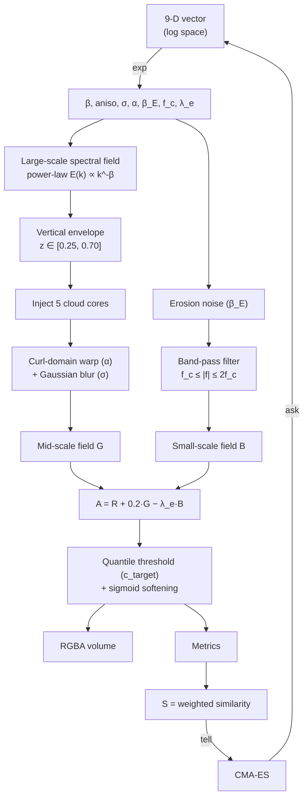
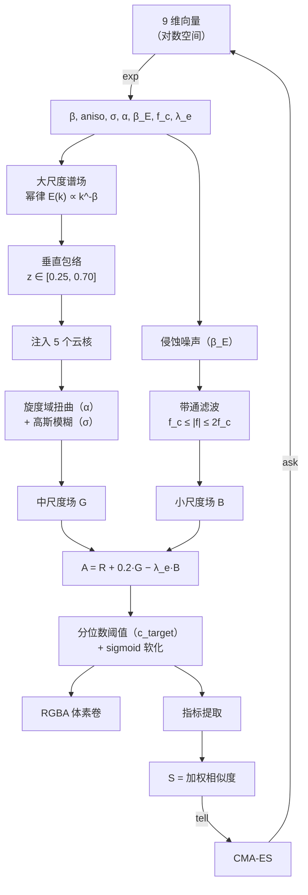

# NubisForge

> Forging 3D volumetric cumulus clouds with evolution — 用进化算法"锻造"体积云。

[English](#english) · [中文](#中文)

---

# English

Procedural generator for **tileable 3D volumetric cloud textures**. A CMA-ES optimizer searches a 9-dimensional meteorological parameter space; each candidate is rendered by a physics-inspired pipeline (spectral turbulence → vertical envelope → curl-domain warp → multi-scale erosion → quantile calibration) and scored against a target set of cloud statistics.

Output is a raw `uint8` RGBA voxel volume plus a JSON sidecar, ready to be uploaded as a 3D texture.

> ⚠️ Status: research prototype, single-file script. No package structure yet.

## Highlights

- **Physics-inspired, not noise-thresholded.** Anisotropic spectral fields with a tunable power-law exponent, warped by a divergence-free curl field, then eroded by a band-passed high-frequency field.
- **Optimizer, not hand-tuning.** 9 parameters are searched by CMA-ES instead of being dialed in by eye.
- **Statistics-driven fitness.** Candidates are scored on coverage, blob count, fractal boundary dimension, aspect ratio, autocorrelation length, spectral slope and hole ratio — not on a single number.
- **Restartable.** Checkpointing, an on-disk experience pool, and an adaptive explorer keep long runs alive across `Ctrl-C`.
- **Reproducible.** Seeds are chosen by warm-up search and frozen into the checkpoint.

## Quick Start

```bash
pip install numpy scipy Pillow cmaes
python Cloud_CMA-ES.py
```

Requires Python 3.9+. First run performs a warm-up seed search, then starts CMA-ES.

### CLI

| Flag | Effect |
|---|---|
| *(none)* | Run; resumes from `cloud_nubis_out/checkpoint.pkl` if present |
| `--reset` | Delete `checkpoint.pkl` and `experience_pool.json` before running |
| `--seed <int>` | Fix the warm-up seed instead of picking one randomly (for reproducible runs) |

All other knobs are module-level constants at the top of `Cloud_CMA-ES.py`:

```python
N_RES     = 128    # final volume resolution (N³)
N_WARMUP  = 64     # resolution used during seed warm-up
MAX_GEN   = 3000   # generation cap
N_WORKERS = 8      # parallel processes
POP_SIZE  = 8      # initial CMA-ES population
C_TARGET  = 0.15   # target volume coverage
```

> BLAS thread counts are forced to `1` on startup — parallelism comes from `N_WORKERS`, and nested threading would oversubscribe the CPU.

## Pipeline



Step by step:

1. **Spectral field.** White noise is generated in Fourier space and shaped by an anisotropic power law `r^(-β/2)` with per-axis scale factors. Normalized to zero mean, unit variance.
2. **Vertical envelope.** A smooth top/bottom mask confines cloud mass to a band, `smoothstep(0.25, 0.30, z) · (1 − smoothstep(0.65, 0.70, z))`.
3. **Cloud cores.** Five Gaussian blobs with randomized centers are blended in to guarantee a blob-like structure.
4. **Curl-domain warp.** A second spectral field is differentiated into a divergence-free curl field. Coordinates are displaced by `α · curl`, with extra horizontal shear applied in the upper half (`smoothstep(0.4, 0.7, z)`). Displacement uses `map_coordinates` with `mode='grid-wrap'`, which keeps the result tileable. Followed by a Gaussian blur of width `σ`.
5. **Multi-scale erosion.** A third spectral field (`β_E`) is band-pass filtered to `[f_c, 2f_c]` and subtracted with weight `λ_e`, carving small-scale cauliflower detail.
6. **Calibration.** The combined field is thresholded at the `1 − c_target` quantile and softened through `sigmoid(8·(A − q))`, so `c_target` is a *coverage control* independent of the field's absolute scale.

Output channels: `R` = large-scale field, `G` = mid-scale field, `B` = small-scale erosion field, `A` = density probability.

## Parameters

Bounds are applied in log space, so the effective search ranges are:

| # | Symbol | Meaning | Range |
|---|---|---|---|
| 0 | `β` | Large-scale spectral exponent | 1.6 – 2.8 |
| 1 | `a_x` | Anisotropy along x | 0.5 – 2.0 |
| 2 | `a_z` | Anisotropy along z | 0.5 – 2.0 |
| 3 | `a_y` | Anisotropy along y | 0.8 – 2.0 |
| 4 | `σ` | Gaussian blur after warp | 0.02 – 0.4 |
| 5 | `α` | Warp strength | 0.05 – 0.8 |
| 6 | `β_E` | Erosion-field spectral exponent | 2.0 – 3.5 |
| 7 | `f_c` | Erosion band-pass lower cutoff | 0.1 – 0.4 |
| 8 | `λ_e` | Erosion weight | 0.005 – 0.05 |

## Reference metrics

Fitness compares extracted statistics against these targets:

| Metric | Target | σ (tolerance) | What it measures |
|---|---|---|---|
| `cov` | 0.15 | 0.03 | Fraction of voxels above density 0.5 |
| `DB` | 1.40 | 0.20 | Box-counting fractal dimension of the boundary (median over 3 z-slices) |
| `aspect` | 1.00 | 0.30 | 95th-percentile column/row projection ratio |
| `Lc` | 0.06 | 0.02 | Autocorrelation length (lag at which ACF drops below 0.5) |
| `beta_x` | 2.00 | 0.40 | Power-spectrum slope along axes |
| `n_blobs` | 5.0 | 1.5 | Median connected-component count over 3 z-slices |
| `hole_ratio` | 0.0 | 0.05 | Filled-holes minus mask, relative to mask volume |

Scoring: per-metric Gaussian kernel `exp(−½((v−t)/σ)²)`, weighted mean, then multiplied by `0.5 + 0.5·min(score)` — a worst-metric penalty that prevents one great metric from masking a bad one.

> The reference values are **empirically calibrated** to a target cumulus morphology. If you adapt this to a specific cloud type or observation dataset, replace `REFERENCE_PHYSICS` and document your source.

## Optimizer design

Beyond plain CMA-ES:

- **Warm-up seed search.** 50 seeds are tested at 64³ with a fixed parameter vector; the highest-scoring seed is frozen for the whole run. This removes seed variance from the optimization signal.
- **Seed injection.** Each generation, one population slot is overwritten with a hand-picked physical seed, and another with the best vector found so far. Guarantees non-degradation.
- **Explorer brain.** An extra candidate per generation, proposed as a blend of (memory of past successful directions) + (differential-evolution direction sampled from the experience pool) + (random). Its direction is reinforced or decayed based on whether it beats the CMA-ES batch.
- **Experience pool.** The top 50 candidates by fitness persist in `experience_pool.json` across runs and feed the explorer's DE directions. Entries carry a `POOL_VERSION` tag and are discarded on schema changes.
- **IPOP restarts.** No improvement for 20 generations → population doubles (up to 16); no improvement for 150 generations → full restart with a fresh CMA-ES.
- **Checkpointing.** Saved every 10 generations, on improvement, and on `Ctrl-C`.

## Output

Written to `cloud_nubis_out/`:

| File | Contents |
|---|---|
| `best_volume_128.bin` | Raw RGBA voxels, `uint8`, layout `[x, z, y, c]`, 8 MB at N=128 |
| `best_volume_128.json` | Shape, dtype, layout, channel semantics |
| `best_slice_xz_R.png` | Z-mid slice of the large-scale channel |
| `best_slice_xz_A.png` | Z-mid slice of the density channel |
| `best_params.json` | Final score, recomputed score, raw 9-D vector, decoded config, all metrics |
| `experience_pool.json` | Persistent top-50 candidate pool |
| `checkpoint.pkl` | Resumable state — deleted on successful convergence |

Loading the volume:

```python
import json, numpy as np
meta = json.load(open("cloud_nubis_out/best_volume_128.json"))
N = meta["shape"][0]
vol = np.fromfile("cloud_nubis_out/best_volume_128.bin", dtype=np.uint8).reshape(N, N, N, 4)
rgba = vol.astype(np.float32) / 255.0
```

## Limitations

- **Linux / macOS recommended.** The script calls `mp.set_start_method("fork")`; on Windows this fails and falls back to `spawn`, which is slower and not tested.
- **Monolithic.** 900+ lines in one file, module-level mutable caches. Refactoring is on the roadmap.
- **CPU only.** Each evaluation is an FFT-heavy `O(N³ log N)` pipeline; there is no GPU path.
- **Metric extraction is heuristic.** `DB` is fit over only 6 box sizes; `Lc` is measured on 3 lines per slice. Directionally correct, not publication-grade.

## Roadmap

- [ ] Split into a package (`nubisforge/{field,physics,metrics,opt}.py`)
- [ ] GIF / video export by sweeping z-slices
- [ ] `--N`, `--gen`, `--workers` as CLI flags
- [ ] GPU backend (PyTorch / CuPy) for the FFT pipeline
- [ ] Presets for cumulus / stratus / cumulonimbus

## License

MIT — see `LICENSE`.

---

# 中文

> 用进化算法"锻造"体积云。

程序化生成**可平铺的 3D 体积云纹理**。CMA-ES 在 9 维气象参数空间中搜索，每个候选解经一套物理启发式流程渲染（谱域湍流 → 垂直包络 → 旋度域扭曲 → 多尺度侵蚀 → 分位数标定），再按一组云统计量打分。

输出为 `uint8` RGBA 体素卷 + 一份 JSON 元数据，可直接作为 3D 纹理上传。

> ⚠️ 状态：研究原型，单文件脚本，尚未组织成包。

## 特点

- **物理启发，不是噪声阈值。** 各向异性幂律谱场，经无散度旋度场扭曲，再被带通高频场侵蚀。
- **靠优化器，不靠手调。** 9 个参数交给 CMA-ES，而不是人眼看图拧。
- **统计量驱动的适应度。** 按覆盖率、连通块数、分形边界维数、长宽比、自相关长度、谱斜率、孔洞率综合评分，而非单一指标。
- **可中断续跑。** 检查点、磁盘经验池、自适应探索器，`Ctrl-C` 之后能接着跑。
- **可复现。** 种子经预热搜索选出并固化进检查点。

## 快速开始

```bash
pip install numpy scipy Pillow cmaes
python Cloud_CMA-ES.py
```

需要 Python 3.9+。首次运行会先做预热种子搜索，再进入 CMA-ES。

### 命令行

| 参数 | 作用 |
|---|---|
| *（无）* | 正常运行；若存在 `cloud_nubis_out/checkpoint.pkl` 则自动续跑 |
| `--reset` | 运行前删除 `checkpoint.pkl` 与 `experience_pool.json` |
| `--seed <int>` | 固定预热种子，而非随机选取（用于可复现实验） |

其余可调项是 `Cloud_CMA-ES.py` 顶部的模块级常量：

```python
N_RES     = 128    # 最终体积分辨率（N³）
N_WARMUP  = 64     # 预热种子搜索用的分辨率
MAX_GEN   = 3000   # 最大代数
N_WORKERS = 8      # 并行进程数
POP_SIZE  = 8      # CMA-ES 初始种群规模
C_TARGET  = 0.15   # 目标体积覆盖率
```

> 启动时会把 BLAS 线程数强制设为 `1`：并行度来自 `N_WORKERS`，嵌套多线程只会让 CPU 超卖。

## 生成流程



逐步说明：

1. **谱场。** 在傅里叶空间生成白噪声，用各向异性幂律 `r^(-β/2)` 塑形，逐轴可调尺度因子。归一到零均值、单位方差。
2. **垂直包络。** 平滑的上下边界把云质量约束在一条带内：`smoothstep(0.25, 0.30, z) · (1 − smoothstep(0.65, 0.70, z))`。
3. **云核。** 混入 5 个随机中心的各向同性高斯团，保证结果具有团块结构。
4. **旋度域扭曲。** 第二个谱场经差分得到无散度的旋度场，坐标按 `α · curl` 位移；上半部（`smoothstep(0.4, 0.7, z)`）额外施加水平切变。位移使用 `map_coordinates` 的 `mode='grid-wrap'`，因此结果保持可平铺。随后做宽度为 `σ` 的高斯模糊。
5. **多尺度侵蚀。** 第三个谱场（`β_E`）带通到 `[f_c, 2f_c]`，以 `λ_e` 为权重相减，刻出小尺度花椰菜细节。
6. **标定。** 合成场在 `1 − c_target` 分位处取阈值，再经 `sigmoid(8·(A − q))` 软化。这样 `c_target` 是独立的**覆盖率控制量**，与场的绝对尺度无关。

输出通道：`R` = 大尺度场，`G` = 中尺度场，`B` = 小尺度侵蚀场，`A` = 密度概率。

## 参数表

边界在对数空间施加，因此有效搜索范围为：

| # | 符号 | 含义 | 范围 |
|---|---|---|---|
| 0 | `β` | 大尺度谱指数 | 1.6 – 2.8 |
| 1 | `a_x` | x 向各向异性 | 0.5 – 2.0 |
| 2 | `a_z` | z 向各向异性 | 0.5 – 2.0 |
| 3 | `a_y` | y 向各向异性 | 0.8 – 2.0 |
| 4 | `σ` | 扭曲后高斯模糊宽度 | 0.02 – 0.4 |
| 5 | `α` | 扭曲强度 | 0.05 – 0.8 |
| 6 | `β_E` | 侵蚀场谱指数 | 2.0 – 3.5 |
| 7 | `f_c` | 侵蚀带通下限 | 0.1 – 0.4 |
| 8 | `λ_e` | 侵蚀权重 | 0.005 – 0.05 |

## 参考指标

适应度将提取的统计量与以下目标比较：

| 指标 | 目标 | σ（容差） | 含义 |
|---|---|---|---|
| `cov` | 0.15 | 0.03 | 密度 > 0.5 的体素占比 |
| `DB` | 1.40 | 0.20 | 边界的盒计数分形维数（3 个 z 切片取中位数） |
| `aspect` | 1.00 | 0.30 | 列/行投影 95 百分位之比 |
| `Lc` | 0.06 | 0.02 | 自相关长度（ACF 降到 0.5 以下的滞后） |
| `beta_x` | 2.00 | 0.40 | 轴向功率谱斜率 |
| `n_blobs` | 5.0 | 1.5 | 3 个 z 切片连通块数的中位数 |
| `hole_ratio` | 0.0 | 0.05 | 填洞前后差值相对掩膜体积的比例 |

评分方式：逐指标高斯核 `exp(−½((v−t)/σ)²)` 加权平均，再乘以 `0.5 + 0.5·min(score)`——最差指标惩罚项，防止某一项特别好掩盖另一项崩溃。

> 参考值是对某种积云形态的**经验标定**。若要适配特定云型或观测数据，请替换 `REFERENCE_PHYSICS` 并注明数据来源。

## 优化器设计

在标准 CMA-ES 之外：

- **预热种子搜索。** 用固定参数向量在 64³ 下测试 50 个种子，取最高分者并固化为全程种子。这消除了种子方差对优化信号的干扰。
- **种子注入。** 每代有一个种群槽位被物理种子覆盖，另一个被当前最优向量覆盖，保证不退化。
- **探索大脑。** 每代额外产生一个候选，方向为「历史成功方向记忆 + 从经验池采样的差分进化方向 + 随机方向」的加权混合。若它击败本代 CMA-ES 最好成绩，则强化该方向，否则衰减。
- **经验池。** 按适应度前 50 的候选持久化在 `experience_pool.json`，跨运行复用，并作为探索器的 DE 方向来源。条目带 `POOL_VERSION` 标签，结构变更时自动丢弃。
- **IPOP 重启。** 连续 20 代无提升 → 种群翻倍（上限 16）；连续 150 代无提升 → 全新 CMA-ES 重启。
- **检查点。** 每 10 代、每次提升、以及 `Ctrl-C` 中断时保存。

## 输出文件

写入 `cloud_nubis_out/`：

| 文件 | 内容 |
|---|---|
| `best_volume_128.bin` | 原始 RGBA 体素，`uint8`，布局 `[x, z, y, c]`，N=128 时 8 MB |
| `best_volume_128.json` | 形状、dtype、布局、通道语义 |
| `best_slice_xz_R.png` | 大尺度通道的 z 中截面 |
| `best_slice_xz_A.png` | 密度通道的 z 中截面 |
| `best_params.json` | 最终得分、重算得分、9 维原始向量、解码配置、全部指标 |
| `experience_pool.json` | 持久化前 50 候选池 |
| `checkpoint.pkl` | 可续跑状态——成功收敛后删除 |

读取体素卷：

```python
import json, numpy as np
meta = json.load(open("cloud_nubis_out/best_volume_128.json"))
N = meta["shape"][0]
vol = np.fromfile("cloud_nubis_out/best_volume_128.bin", dtype=np.uint8).reshape(N, N, N, 4)
rgba = vol.astype(np.float32) / 255.0
```

## 已知限制

- **推荐 Linux / macOS。** 脚本调用 `mp.set_start_method("fork")`，Windows 下会失败并回退到 `spawn`，速度更慢且未测试。
- **单文件巨石。** 900+ 行挤在一个文件里，含模块级可变缓存。重构在路线图上。
- **仅 CPU。** 每次评估都是 FFT 密集的 `O(N³ log N)` 流程，无 GPU 路径。
- **指标提取是启发式的。** `DB` 只用 6 个盒子尺寸拟合；`Lc` 每切片只测 3 条线。方向正确，未达论文级严谨。

## 路线图

- [ ] 拆分为包（`nubisforge/{field,physics,metrics,opt}.py`）
- [ ] 沿 z 扫描输出 GIF / 视频
- [ ] `--N`、`--gen`、`--workers` 提为 CLI 参数
- [ ] GPU 后端（PyTorch / CuPy）加速 FFT 流程
- [ ] 积云 / 层云 / 积雨云预设

## 许可证

MIT，见 `LICENSE`。
